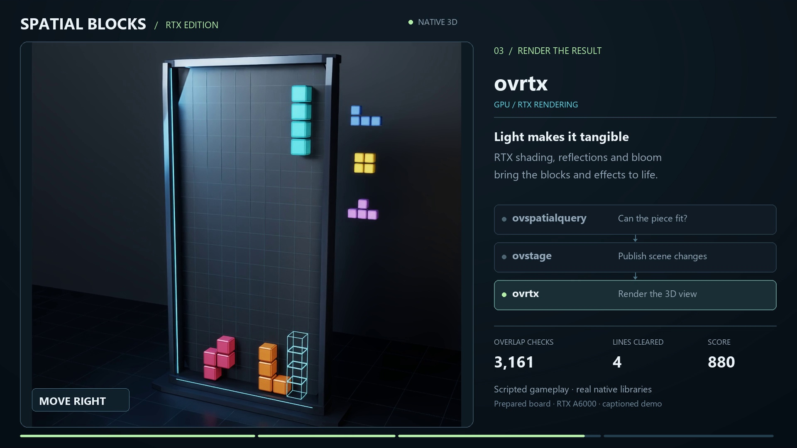

# Spatial Blocks - RTX Edition

A playable falling-block game that combines **ovspatialquery** placement checks with **ovstage** scene updates and **ovrtx** rendering. Classic 10 x 20 gameplay is presented as textured, beveled 3D blocks with reflections, shadows, bloom, sparks, and an orbitable camera. A CPU-only 2D edition is also included.

[](share/Spatial-Blocks-RTX-Demo.mp4)

**[Watch or download the 14-second demo](https://github.com/neelkm/spatial-blocks-rtx/raw/refs/heads/main/share/Spatial-Blocks-RTX-Demo.mp4)** · **[Architecture overview (PDF)](share/Spatial-Blocks-Architecture.pdf)** · **[Overview as text](share/Spatial-Blocks-Architecture.md)**

The 1080p demo uses a prepared board and scripted inputs through the real libraries. Its built-in captions explain placement checks, scene publication, and rendering; the clip is silent.

## Run locally

This is a local desktop game with a browser interface. The 3D view is rendered by the native ovrtx library on your NVIDIA GPU, then displayed in the browser. GitHub hosts the source and demonstration media; it does not run the native game.

### Requirements

- Windows x64 and Python 3.12 for the supplied 3D environment and launchers.
- An RTX-capable NVIDIA GPU and a [supported driver](https://nvidia-omniverse.github.io/ovrtx/driver_requirements.html) for 3D play. Tested on an RTX A6000 with driver 597.06.
- Git, plus the C++ build prerequisites documented by ovspatialquery.
- **Authorized access to [ovspatialquery-prototype](https://github.com/NVIDIA-dev/ovspatialquery-prototype)** and its build dependencies. That upstream repository is currently private. This public game repository contains neither its source nor its installed binaries. Readers without access can view the game source and demo, but cannot run its native placement backend.

### Setup

Clone the game and the dependency into sibling folders. The following PowerShell commands pin the spatial library to the revision used by this game:

```powershell
git clone https://github.com/neelkm/spatial-blocks-rtx.git
git clone https://github.com/NVIDIA-dev/ovspatialquery-prototype.git
Set-Location ovspatialquery-prototype
git checkout 3724a03cf5c5960b90fe7d4d9f1e27754c90fdfe
.\dev.ps1 bootstrap -Scope Library
Set-Location ..\spatial-blocks-rtx
py -3.12 -m venv .venv3d
& .\.venv3d\Scripts\python.exe -m pip install -r requirements3d.txt
```

After successful installation, double-click **Play Spatial Blocks 3D.cmd**, then click **Let's play** or press Enter. First GPU initialization can take several minutes while shaders compile. The interface shows the startup state until rendering is ready. Use **Close game** to stop the local server and release native resources.

For the 2D edition, double-click **Play Spatial Blocks.cmd** after bootstrapping ovspatialquery; it requires no RTX renderer. See [the 2D guide](README-2D.md) and [the 3D guide](README-3D.md) for more detail.

If the dependency is elsewhere, set `OVSPATIALQUERY_REPO` to its checkout directory. `OVSPATIALQUERY_LIBRARY` can override the native DLL path. No workstation-specific paths are required.

### Controls

| Control | Action |
| --- | --- |
| Left / right, A / D | Move |
| Up, W, X | Rotate clockwise |
| Z, Q | Rotate counterclockwise |
| Down, S | Soft drop |
| Space | Hard drop |
| P, Escape | Pause / resume |
| Enter | Start / resume / play again |
| R | New game |
| Drag the 3D scene | Orbit the camera |
| Scroll over the 3D scene | Zoom |
| 1 / 2 | Front / perspective view |

Switching browser tabs pauses play. Touch controls are included.

## How it works

| Component | Responsibility |
| --- | --- |
| Python game rules | Gravity, rotations, wall kicks, piece locking, scoring, and line clearing |
| ovspatialquery | Real CPU `overlap_any` queries validate movement, rotations, and ghost landing positions against settled blocks |
| ovstage | Loads the OpenUSD scene and publishes versioned transform and material updates |
| ovrtx | Renders the scene using real-time path tracing, lighting, reflections, shadows, and bloom |
| Local browser interface | Sends inputs and displays JPEG frames from the native renderer |

Settled blocks share one registered box geometry in an explicit spatial population. Board bounds are checked arithmetically; native overlap queries decide whether a candidate cell is occupied. Query boxes are slightly inset so touching neighboring cells remain legal. Locking and clearing publish changed and removed objects while preserving surviving object identities.

The 3D scene preallocates blocks, landing guides, sparks, and light trails. Persistent ovstage queries update transforms and material bindings. Each change is published at an ordinal (a scene version), and ovrtx renders that version. Mapped frame memory is copied through DLPack and released before rendering advances. One Python thread owns gameplay and native rendering; queued browser inputs keep those operations ordered.

The server binds to `127.0.0.1`. All scene textures are generated locally; the game does not fetch remote scene assets during play.

## Source guide

| File or folder | Contents |
| --- | --- |
| `game.py` | Shared gameplay logic |
| `spatial_backend.py` | Native ovspatialquery integration |
| `scene3d.py`, `assets3d/` | Procedural geometry, textures, and generated OpenUSD scene |
| `renderer3d.py` | Scene updates, native rendering, camera, and effects |
| `app3d.py`, `web3d/` | 3D local server and browser interface |
| `app.py`, `web/` | 2D local server and browser interface |
| `test_game.py`, `browser-check*.cjs` | Native integration and browser checks |
| `share/` | Video, preview image, captions, and architecture overview |
| `capture_team_video.py`, `verify_team_video.py` | Reproduce and verify the captioned video |

## Verification and demo capture

With the dependencies installed:

```powershell
& .\.venv3d\Scripts\python.exe -m unittest -v test_game
```

The 12 integration tests use the real spatial library. Browser checks cover controls, native output, line clearing, camera interaction, touch layouts, and request-origin restrictions; instructions are in the edition guides.

To reproduce the 14-second video with a separate game session:

```powershell
& .\.venv3d\Scripts\python.exe -m pip install -r requirements-capture.txt
& .\.venv3d\Scripts\python.exe capture_team_video.py
& .\.venv3d\Scripts\python.exe verify_team_video.py
```

Capture uses the Windows Segoe UI fonts and writes the MP4 to `share/`. Its logs, evidence, and review frames go to ignored `share/production/`. Normal gameplay does not require the capture dependencies.

## Dependencies

The 3D environment pins ovrtx `0.5.0.377615`, ovstage `0.2.0.377349`, NumPy `2.2.6`, Pillow `12.1.1`, and usd-core `26.8`. The game integrates with the [ovrtx project](https://github.com/nvidia-omniverse/ovrtx) and the separately obtained ovspatialquery prototype. Third-party runtimes are installed separately and remain subject to their respective terms; they are not bundled here.
